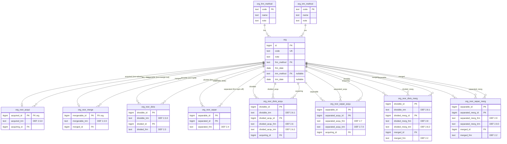

# ER: жизненный цикл `org` и правопреемство (итерация 0)

**Статус:** схема + DDL applied на `maps_db@10.7.0.3:5434` (2026-11-25); seed AT→DE + `japan`; VERIFY OK.  
**План чата:** [26-1124_01_org_lifecycle.md](../chat/plan/26-1124_01_org_lifecycle.md)  
**Канон решений:** [26-1124_org_lifecycle_iteration0.md](26-1124_org_lifecycle_iteration0.md)  
**Источник каркаса:** MS SQL `FishEye_prod_noM6` / `ags.rgTax*` / `ags.rgTaxReor*` (снято 2026-11-24).

**Объём этого документа:** лицо + справочники frm/trm + таблицы реорганизации.  
**Вне объёма:** имена (`rgTaxName*`), Membership / `part_of`, оккупация, `org_type`, связь с legacy `org.sovereign` (таблицу `sovereign` не трогаем — устаревшая).

---

## 1. Решения по именованию

**Правило:** имена таблиц ЖЦ начинаются с префикса **`org_`** (плюс уточнение); лицо — `org` (полное имя `org.org`).  
Колонки: `snake_case`, без повторного префикса таблицы.

| Postgres (`org.*`) | Источник FishEye |
|--------------------|------------------|
| `org` | `rgTaxMnStRegNum` без налогов/региона/`og` |
| `org_frm_method` | `rgTaxLgEntFrmMtd` |
| `org_trm_method` | `rgTaxLgEntTrmMtd` |
| `org_reor_acqui` | `rgTaxReorAcqui` |
| `org_reor_merge` | `rgTaxReorMerge` |
| `org_reor_divis` | `rgTaxReorDivis` |
| `org_reor_separ` | `rgTaxReorSepar` |
| `org_reor_divis_acqu` | `rgTaxReorDivisAcqu` |
| `org_reor_separ_acqu` | `rgTaxReorSeparAcqu` |
| `org_reor_divis_merg` | `rgTaxReorDivisMerg` |
| `org_reor_separ_merg` | `rgTaxReorSeparMerg` |
| — (нет таблицы) | `rgTaxReorTrans` → у нас **convert = same id** |

- Суррогатный `org.id` (`bigint`), человеческий `org.code` (`text`, UNIQUE).  
- Сочетания 2.6–2.9 — **пустой каркас** таблиц сразу; наполнять по кейсам.  
- Согласовано 2026-11-25: префикс `org_` на таблицах-спутниках.

---

## 2. Снятая структура источника (сжато)

### 2.1. Лицо `ags.rgTaxMnStRegNum`

PK источника: `(SignYY, TaxRegion, RecNum)` → поле `rtmsrnCode` (ОГРН, 13).  
Для ЖЦ существенны: `FrmMtd`+`FrmDate` (NOT NULL), `TrmMtd`+`TrmDate` (NULL).  
Не переносим: TaxRegion, TaxType, `og`, DateAssign и пр.

### 2.2. Справочники (коды ФНС, как в FishEye)

| frm | смысл | trm | смысл |
|-----|--------|-----|--------|
| `1.0` | создание с нуля | `0.0.0` | ликвидация без преемника |
| `2.1` | преобразование (создание) | `2.1.0` | преобразование (прекращение) |
| `2.2` | слияние → новое | `2.2.0` | ушёл в слияние |
| `2.3` | разделение → новое | `2.3.0` | разделён |
| `2.4` | выделение → новое | `2.5.0` | присоединён |
| `2.6`…`2.9` | сочетания (промежуточные id) | `2.6.*`…`2.9.0` | сочетания |

Исторические коды `1.з` / `2.г` (до 01.07.2002) в seed итерации 0 **не обязательны**.

### 2.3. Базовые Reor* (колонки + DEFAULT method)

| Таблица | PK | Роли | DEFAULT method |
|---------|-----|------|----------------|
| `rgTaxReorAcqui` | `rAcquired` | acquired → acquiring | acquired_trm=`2.5.0` |
| `rgTaxReorMerge` | `rMergerable` | mergerable → merged | mergerable_trm=`2.2.0` |
| `rgTaxReorDivis` | (divisible, divided) | old dies / new born | divisible_trm=`2.3.0`, divided_frm=`2.3` |
| `rgTaxReorSepar` | (separable, separated) | parent жив / new born | separated_frm=`2.4` |

Паттерн целостности источника: составной FK `(id, method)` → `(MnStRegNum…, FrmMtd|TrmMtd)` плюс DEFAULT на колонке ребра. В Postgres — то же через `UNIQUE (id, frm_method)` / `UNIQUE (id, trm_method)` на `org.org`.

### 2.4. Сочетания (каркас)

| Таблица | Смысл | DEFAULT |
|--------|--------|---------|
| `DivisAcqu` | разделение + присоединение к существующему | 2.6 / 2.6.1 / 2.6.2 |
| `SeparAcqu` | выделение + присоединение | 2.7 / 2.7.0 |
| `DivisMerg` | разделение + слияние в новое | 2.8.* + merged frm `2.2` |
| `SeparMerg` | выделение + слияние в новое | 2.9.* + merged frm `2.2` |

---

## 3. ER Postgres (предложение)

---

## 4. Правила на схеме

1. **convert** — таблицы `org_reor_trans` нет; тот же `org.id`, меняются только имена (итерация 0.5 / соседний `name_form`).  
2. **Составные FK** (как в `rgTax`): например `org_reor_acqui (acquired_id, acquired_trm) → org (id, trm_method)`.  
3. **DEFAULT method** на колонках рёбер — коды из §2.3–2.4.  
4. **UK на лице** для целей FK: `UNIQUE (id, frm_method)`, `UNIQUE (id, trm_method)`.  
5. **Сочетания** — пустой каркас сразу; наполнять по прецедентам.  
6. **`org.sovereign`** — не изменять; новый контур — с нуля.  
7. **Двусторонняя целостность method ↔ Reor** — вариант **A** (2026-11-25):  
   - ребро → лицо: составной FK + DEFAULT (как FishEye);  
   - лицо → ребро: `CONSTRAINT TRIGGER … DEFERRABLE INITIALLY DEFERRED` (см. §4.1);  
   - вариант B (method только из ребра) для итерации 0 **отклонён**;  
   - SQL-функции API (`org_absorb` / …) — позже, дополнением, не заменой ограничений.

DDL: [`scripts/sql/013_org_lifecycle.sql`](../../scripts/sql/013_org_lifecycle.sql).

### 4.1. Матрица «method требует ребра»

| Method на `org` | Обязательное ребро |
|-----------------|-------------------|
| frm `1.0` | — |
| frm `2.2` | `org_reor_merge` как **merged** |
| frm `2.3` | `org_reor_divis` как **divided** |
| frm `2.4` | `org_reor_separ` как **separated** |
| frm `2.6` | `org_reor_divis_acqu` как **divided_acqu** |
| frm `2.7` | `org_reor_separ_acqu` как **separated_acqu** |
| frm `2.8` | `org_reor_divis_merg` как **divided_merg** |
| frm `2.9` | `org_reor_separ_merg` как **separated_merg** |
| trm `0.0.0` | — |
| trm `2.2.0` | `org_reor_merge` как **mergerable** |
| trm `2.3.0` | `org_reor_divis` как **divisible** |
| trm `2.5.0` | `org_reor_acqui` как **acquired** |
| trm `2.6.1` | `org_reor_divis_acqu` как **divisible** |
| trm `2.6.2` | `org_reor_divis_acqu` как **divided_acqu** |
| trm `2.7.0` | `org_reor_separ_acqu` как **separated_acqu** |
| trm `2.8.1` | `org_reor_divis_merg` как **divisible** |
| trm `2.8.2` | `org_reor_divis_merg` как **divided_merg** |
| trm `2.9.0` | `org_reor_separ_merg` как **separated_merg** |
| trm `2.1.0` / frm `2.1` | — (convert = same id; Trans нет) |

Триггеры **DEFERRABLE INITIALLY DEFERRED**: в одной транзакции допустимы `INSERT org` затем `INSERT org_reor_*`; проверка — на `COMMIT`.  
DELETE/UPDATE ребра не должен оставлять method на лице без соответствующего ребра (и наоборот).

---

## 5. Прецеденты на данных (`maps_db`)

### 5.1. Absorb: Австрия → Германия

| факт | где |
|------|-----|
| AT: `trm_method = 2.5.0`, `trm_date = 1938-03-13` | `org.org` (`code=austria`) |
| DE живёт, `frm_method = 1.0`, `frm_date = 1871-01-18` | `org.org` (`code=germany`) |
| ребро acquired = AT → acquiring = DE | `org_reor_acqui` |

Критерий: прекращение выражено **присоединением с правопреемником**, а не только датой на лице.

### 5.2. Convert (ЖЦ id): Япония

| факт | где |
|------|-----|
| `japan`, `frm_method = 1.0`, `frm_date = 0660-02-11 BC`, trm NULL | `org.org` |
| нет ребра Reor | — |
| Мэйдзи / 1947 | тот же id; облики — соседний `name_form` / `sovereign_name_form` |

`frm_date` — **легендарный учётный якорь** (Дзимму / National Foundation Day), не научная дата основания. Коды `2.1` / `2.1.0` на лице для гос. convert **не ставим**.

Seed обоих прецедентов — в [`013_org_lifecycle.sql`](../../scripts/sql/013_org_lifecycle.sql).

---

## 6. Решения по открытым пунктам (2026-11-25)

| Тема | Решение |
|------|---------|
| Имена таблиц | лицо `org`; спутники `org_*` |
| Seed `1.з` / `2.г` | **нет** в итерации 0 |
| `org_type` / имена под id | **после** DDL ЖЦ+Reor (0.5+) |
| AT→DE | seed `1938-03-13`; codes `austria` / `germany` |
| Japan | seed `0660-02-11 BC`, `frm=1.0`; convert без Trans |
| Горизонт / Separ | ствол `frm=1.0` обрезает регресс предков; Separ — точечно |
| Целостность method↔Reor | вариант **A** (§4.1); B отклонён |
| Apply | ✅ `maps_db` 2026-11-25 |
