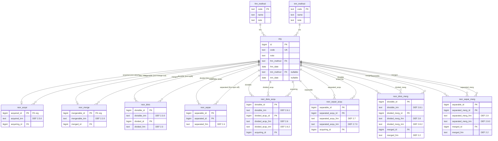

# ER: жизненный цикл `org` и правопреемство (итерация 0)

**Статус:** черновик схемы (2026-11-24); DDL в `maps_db` ещё не применён.  
**План чата:** [26-1124_01_org_lifecycle.md](../chat/plan/26-1124_01_org_lifecycle.md)  
**Канон решений:** [26-1124_org_lifecycle_iteration0.md](26-1124_org_lifecycle_iteration0.md)  
**Источник каркаса:** MS SQL `FishEye_prod_noM6` / `ags.rgTax*` / `ags.rgTaxReor*` (снято 2026-11-24).

**Объём этого документа:** лицо + справочники frm/trm + таблицы реорганизации.  
**Вне объёма:** имена (`rgTaxName*`), Membership / `part_of`, оккупация, `org_type`, связь с legacy `org.sovereign` (таблицу `sovereign` не трогаем — устаревшая).

---

## 1. Решения по именованию (предложение)

| Postgres (`org.*`) | Источник FishEye |
|--------------------|------------------|
| `org` | `rgTaxMnStRegNum` без налогов/региона/`og` |
| `frm_method` | `rgTaxLgEntFrmMtd` |
| `trm_method` | `rgTaxLgEntTrmMtd` |
| `reor_acqui` | `rgTaxReorAcqui` |
| `reor_merge` | `rgTaxReorMerge` |
| `reor_divis` | `rgTaxReorDivis` |
| `reor_separ` | `rgTaxReorSepar` |
| `reor_divis_acqu` | `rgTaxReorDivisAcqu` |
| `reor_separ_acqu` | `rgTaxReorSeparAcqu` |
| `reor_divis_merg` | `rgTaxReorDivisMerg` |
| `reor_separ_merg` | `rgTaxReorSeparMerg` |
| — (нет таблицы) | `rgTaxReorTrans` → у нас **convert = same id** |

- Суррогатный `org.id` (`bigint`), человеческий `org.code` (`text`, UNIQUE).  
- Колонки: `snake_case`, английские имена.  
- Сочетания 2.6–2.9 — **пустой каркас** таблиц сразу; наполнять по кейсам.

---

## 2. Снятая структура источника (сжато)

### 2.1. Лицо `ags.rgTaxMnStRegNum`

PK источника: `(SignYY, TaxRegion, RecNum)` → поле `rtmsrnCode` (ОГРН, 13).  
Для ЖЦ существенны: `FrmMtd`+`FrmDate` (NOT NULL), `TrmMtd`+`TrmDate` (NULL).  
Не переносим: TaxRegion, TaxType, `og`, DateAssign и пр.

### 2.2. Справочники (коды ФНС, как в FishEye)

| frm | смысл | trm | смысл |
|-----|--------|-----|--------|
| `1.0` | создание с нуля | `0.0.0` | ликвидация без преемника |
| `2.1` | преобразование (создание) | `2.1.0` | преобразование (прекращение) |
| `2.2` | слияние → новое | `2.2.0` | ушёл в слияние |
| `2.3` | разделение → новое | `2.3.0` | разделён |
| `2.4` | выделение → новое | `2.5.0` | присоединён |
| `2.6`…`2.9` | сочетания (промежуточные id) | `2.6.*`…`2.9.0` | сочетания |

Исторические коды `1.з` / `2.г` (до 01.07.2002) в seed итерации 0 **не обязательны**.

### 2.3. Базовые Reor* (колонки + DEFAULT method)

| Таблица | PK | Роли | DEFAULT method |
|---------|-----|------|----------------|
| `rgTaxReorAcqui` | `rAcquired` | acquired → acquiring | acquired_trm=`2.5.0` |
| `rgTaxReorMerge` | `rMergerable` | mergerable → merged | mergerable_trm=`2.2.0` |
| `rgTaxReorDivis` | (divisible, divided) | old dies / new born | divisible_trm=`2.3.0`, divided_frm=`2.3` |
| `rgTaxReorSepar` | (separable, separated) | parent жив / new born | separated_frm=`2.4` |

Паттерн целостности источника: составной FK `(org_code, method)` → `(MnStRegNum.code, FrmMtd|TrmMtd)` плюс DEFAULT на колонке ребра. В Postgres — то же через `UNIQUE (id, frm_method)` / `UNIQUE (id, trm_method)` на `org`.

### 2.4. Сочетания (каркас)

| Таблица | Смысл | DEFAULT |
|--------|--------|---------|
| `DivisAcqu` | разделение + присоединение к существующему | 2.6 / 2.6.1 / 2.6.2 |
| `SeparAcqu` | выделение + присоединение | 2.7 / 2.7.0 |
| `DivisMerg` | разделение + слияние в новое | 2.8.* + merged frm `2.2` |
| `SeparMerg` | выделение + слияние в новое | 2.9.* + merged frm `2.2` |

---

## 3. ER Postgres (предложение)

---

## 4. Правила на схеме

1. **convert** — таблицы `reor_trans` нет; тот же `org.id`, меняются только имена (итерация 0.5 / соседний `name_form`).  
2. **Составные FK** как в источнике, например `reor_acqui (acquired_id, acquired_trm) → org (id, trm_method)`.  
3. **DEFAULT method** на колонках рёбер — коды из §2.3–2.4.  
4. **Сочетания** — пустой каркас сразу; наполнять по прецедентам.  
5. **`org.sovereign`** — не изменять в этой итерации; новый контур — с нуля.

---

## 5. Прецедент-ориентир: Австрия → Германия

| факт | где |
|------|-----|
| AT: `trm_method = 2.5.0`, `trm_date = 1938-…` | `org` |
| DE живёт | `org` |
| ребро acquired = AT → acquiring = DE | `reor_acqui` |

Критерий: прекращение выражено **присоединением с правопреемником**, а не только датой на лице.

---

## 6. Открыто к согласованию

- Финальные имена таблиц/колонок (`org` vs `organization`, префиксы `reor_*`).  
- Включать ли seed-коды `1.з` / `2.г`.  
- Момент появления `org_type` и таблиц имён (0 vs 0.5).  
- Точная дата/формулировка прецедента AT→DE для seed.
