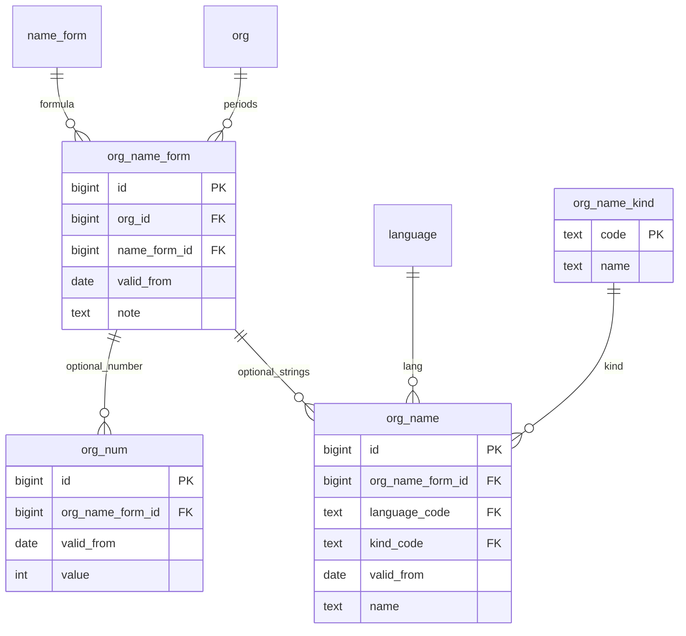

# ER: имена `org` (итерация 1.8 / 0.5) — решения

**Статус:** DDL+seed applied на `maps_db` 2026-11-27 (`018_org_name.sql`); VERIFY DE/AT/JP OK.  
**DDL:** [`018_org_name.sql`](../../scripts/sql/018_org_name.sql).  
**План:** [26-1124_01_org_lifecycle.md](../chat/plan/26-1124_01_org_lifecycle.md) §2 / 1.8.  
**Дерево формул (без ломки):** [README.md](README.md), [26-1102_presentation_sketch.md](26-1102_presentation_sketch.md), DDL `010`–`012`.  
**ЖЦ:** [26-1124_org_lifecycle_er.md](26-1124_org_lifecycle_er.md).  
**Legacy:** `org.sovereign` / `sovereign_name_form` — **не трогать**; зеркальный seed периодов на `org.org`.

---

## 1. Разделение слоёв

| Слой | Отвечает на | Хранение |
|------|-------------|----------|
| `name_form` + edge + label + туннели | какая **полка/формула** и куда в UI-дереве языка L | уже есть |
| `org_name_form` | в какие даты этот `org` сидит на формуле X | новое |
| `org_num` | целочисленный **номер** в пределах периода формулы | новое |
| `org_name` | несводимая **строка** (полное/краткое/…) на языке L | новое, **не обязательно** |

**Не смешивать:** основа (`reich`) ≠ государство ≠ полный титул («Großdeutsches Reich»).  
Дерево `name_form` не кодирует Absorb/Merge; convert = тот же `org.id`, новые периоды формы/имён.

---

## 2. ER (v0)

```text
org.org
   └──< org_name_form >── name_form
            │  valid_from DATE NOT NULL
            │
            ├──< org_name >── language
            │       │  valid_from DATE NOT NULL
            │       │  name TEXT NOT NULL
            │       └── org_name_kind  { full | short | … }
            │
            └──< org_num
                    valid_from DATE NOT NULL
                    value INT NOT NULL
```



### 2.1. Ключи v0

| Таблица | UNIQUE / смысл |
|---------|----------------|
| `org_name_kind` | PK `code` — seed: `full`, `short` |
| `org_name_form` | `(org_id, valid_from)` — одна смена формулы на org в момент |
| `org_name` | `(org_name_form_id, language_code, kind_code, valid_from)` |
| `org_num` | `(org_name_form_id, valid_from)` |

`is_primary` с legacy не переносим: при одной цепи на org достаточно `valid_from`.  
`name_form.assignable` по-прежнему ограничивает, какие формулы можно ставить на период.

---

## 3. Временна́я модель: только `valid_from`

Колонки `valid_to` **нет**. Конец — **вычисляемый** (VIEW + `LEAD`), half-open `[valid_from, next)`.

| Объект | effective_to |
|--------|----------------|
| `org_name_form` | `LEAD(valid_from)` следующего периода **того же org**; иначе `org.trm_date`; иначе NULL (открыто) |
| `org_name` | `LEAD(valid_from)` следующей строки той же `(form, lang, kind)`; иначе effective_to **родительской** формы |
| `org_num` | `LEAD(valid_from)` следующего номера той же формы; иначе effective_to родительской формы |

Смысл: вид действует до следующего такого же вида в пределах формы → до следующей формы → до конца `org`.

Календарь — **вариант A** (григориан в колонке DATE), как в ЖЦ.  
Инварианты (дока / позже триггеры): `org_name_form.valid_from >= org.frm_date`; имя и номер — `valid_from` внутри effective-интервала родительской формы.

---

## 4. Номер (`org_num`) — не только ВС

`value INT NOT NULL` — целое; **не** хранить «5.» / «5th» в БД.

Оформление числительного — **правило языка** при склейке (de: `5.`; en: `5th`; fr: `5e`…).

Примеры применения номера:

| Контекст | Пример |
|----------|--------|
| ВС | 5. Panzer-Division |
| Школа / часть | «школа № 12» |
| Департамент / округ | arrondissement 16 (Париж); ведомственный номер |

Строк `org_num` может не быть (Япония-государство). Наличие номера **не** привязано к «военному» `org_type`.

---

## 5. Когда нужен `org_name`, когда достаточно полки + номера

**Минимум (часто для нумерованных единиц):**  
`name_form` (путь/ярлыки L) + `org_num.value` → **вычисляемое** отображаемое имя.

Пример: путь Division ← Panzer, `value = 5` → de «5. Panzer-Division» без строк в `org_name`.

**`org_name` нужен**, когда строка **не сводится** к полке + номеру:

- полный государственный титул («Großdeutsches Reich», «Dai-Nippon Teikoku»);
- почётное / собственное имя («Das Reich» у дивизии);
- краткое имя, идиома, картографический ярлык, не выводимый из дерева.

| Ситуация | `org_num` | `org_name` |
|----------|-----------|------------|
| Типовая 5. Panzer-Division | да | нет |
| Та же дивизия + «Das Reich» | да (если номер есть) | да (full/honor) |
| Государство без номера | нет | обычно да (full ± short) |
| 16-й округ Парижа | да | опционально (если нужно имя сверх «16e arr.») |

Kind v0: `full`, `short`. Расширения (`honor`, `map`, …) — через справочник, не отдельные таблицы.

---

## 6. Сборка показа (на дату D, язык L)

1. `org_name_form`, где D ∈ `[from, effective_to)`.  
2. `org_num` с max(`valid_from`) ≤ D в этой форме (если есть).  
3. `org_name` (`full` / `short`, L) с max(`valid_from`) ≤ D (если есть).  
4. Полка UI — алгоритм туннелей `name_form` для L (канон 1102 / README).  
5. Если есть несводимый `org_name` — он задаёт (или дополняет) текст; иначе композит **номер + ярлыки пути формулы** по шаблону L.

Шаблоны склейки (порядок слов, точки, суффиксы) — вне таблиц фактов; код/VIEW позже.

---

## 7. Связь с существующим `name_form`

- Смысловой DAG, `name_form_edge_label`, туннели — **без переделки** в 1.8.  
- Новые вершины (division, panzer, arrondissement, school, …) — **отдельным seed** по мере прецедентов; не смешивать с reich/empire без нужды.  
- Перенос периодов DE/AT/JP с `sovereign_name_form` → `org_name_form` (+ `org_name` из `note`); legacy не DELETE.  
- VIEW «дерево L» (план 26-1029) — после DDL имён, не блокирует.

---

## 8. Вне v0 / позже

- Параллельные формулы на один org в один момент.  
- `valid_to` / явные разрывы (gap).  
- Несколько номеров на одну форму в один момент.  
- Жёсткие триггеры ⊆ ЖЦ.  
- Полный seed военных/муниципальных `name_form`.  
- Sync class-диаграммы.

---

## 9. Реализация

| Шаг | Статус |
|-----|--------|
| DDL `018` + VIEW effective | ✅ 2026-11-27 |
| Seed kind + периоды/full DE·AT·JP | ✅ |
| Прецедент `org_num` (округ / дивизия) | ☐ |
| Период AT после 1867 (Австро-Венгрия) | ☐ — пока `kaisertum` effective_to = trm Absorb 1938 |

**Замечание AT:** без следующего `org_name_form` после 1867-06-08 конец периода тянется до `austria.trm` (1938-03-13). Уточнить отдельным периодом формулы, когда появится seed Австро-Венгрии.
