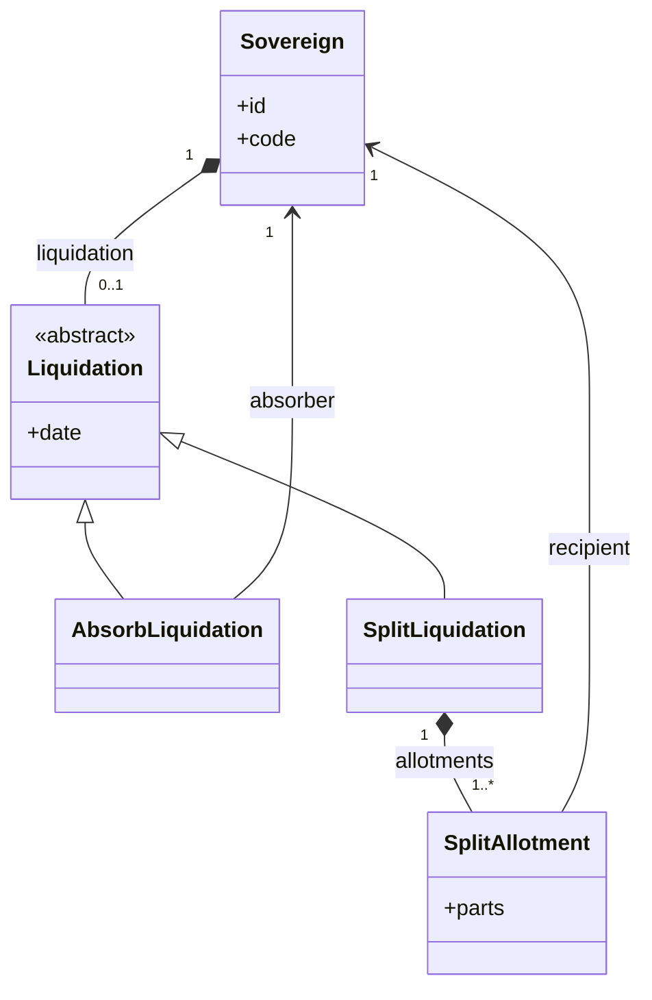
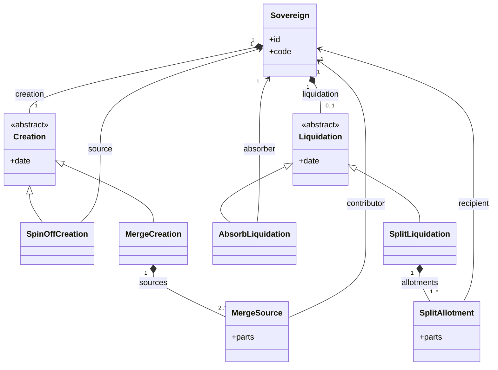
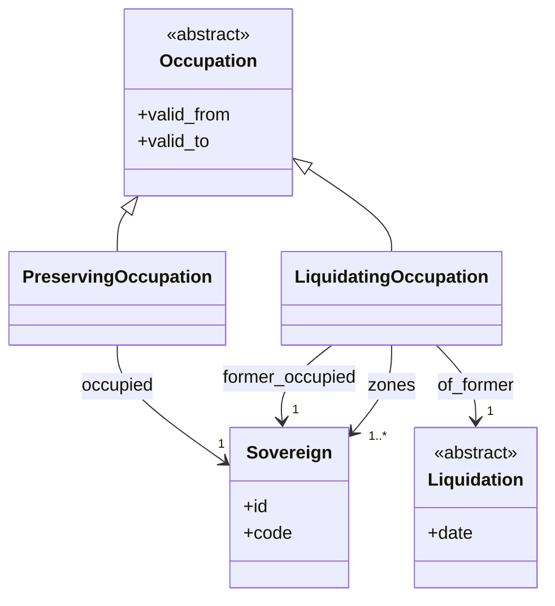
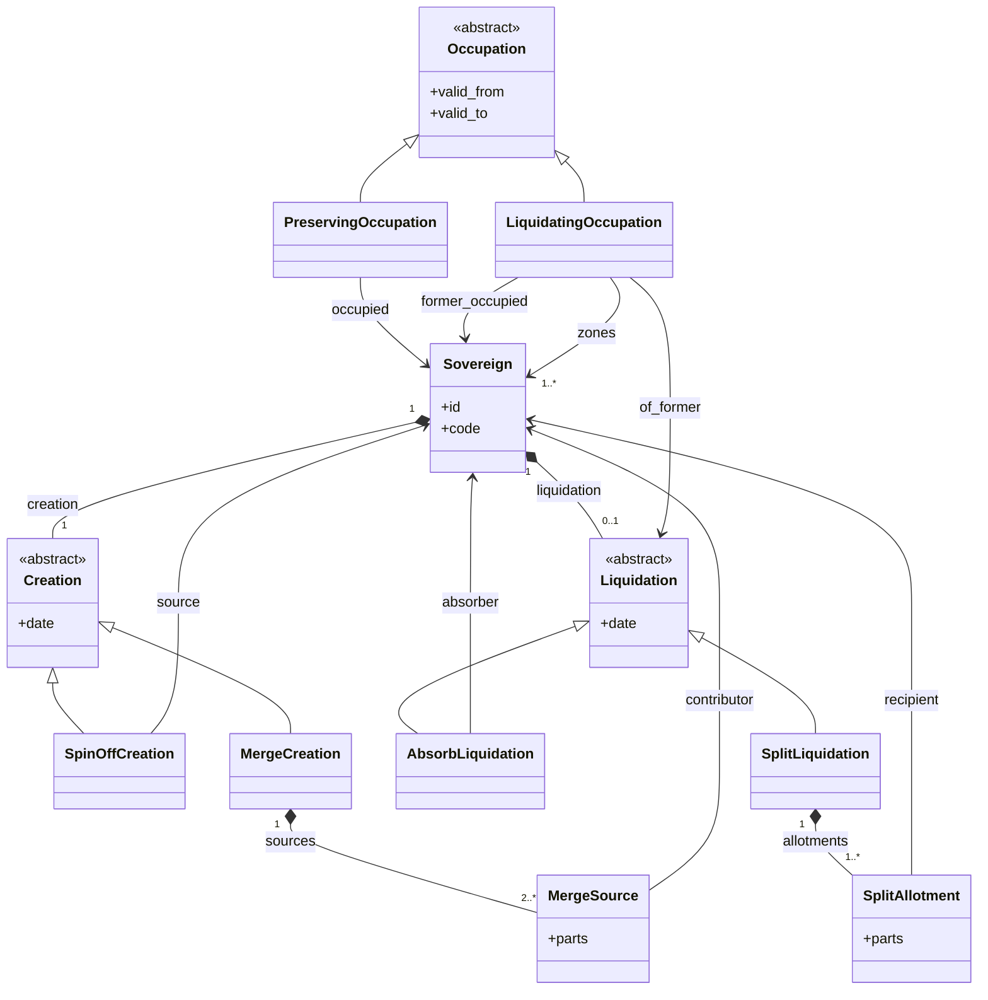

# Схема классов: суверен — жизненный цикл и связи

**Статус:** рабочий эскиз; фиксируем **по сегментам**.  
**Смысл:** [sovereign_transformation.md](sovereign_transformation.md).  
**Кейс-ориентир:** Австрия / Германия / Австро-Венгрия / ОЗ / ФРГ.

**Как смотреть:** [sovereign_class_diagram.svg](sovereign_class_diagram.svg) или Markdown Preview (`Ctrl+Shift+V`).

---

## Сегмент 1 (зафиксирован): ликвидация

Ликвидация — **не** набор полей-флагов на `Sovereign` и **не** `SovereignLink`.

| Класс | Роль |
|-------|------|
| `Liquidation` | **Абстрактный.** Общее: `date`. Композиция у ликвидируемого `Sovereign` (0..1). |
| `AbsorbLiquidation` | `absorber` → поглотивший `Sovereign`. Ребра связи из‑за поглощения нет. |
| `SplitLiquidation` | Коллекция `SplitAllotment`. |
| `SplitAllotment` | `parts` (что отошло) + `recipient` → получивший `Sovereign`. |

| Ликвидируемый | date | Вид | Детали |
|---------------|------|-----|--------|
| Австрия (111) | 1938 | `AbsorbLiquidation` | `absorber` = `germany` |
| Австро-Венгрия | 1918 | `SplitLiquidation` | allotments → получатели |
| `germany` | ~1945 | *уточнить* | затем разрыв без германского государства |

---

## Сегмент 2 (зафиксирован): создание

Создание — тоже **класс** (не только дата на строке). У каждого суверена — композиция к объекту создания (как появился в учёте).

| Класс | Роль |
|-------|------|
| `Creation` | **Абстрактный.** Общее: `date` (дата создания). Композиция у создаваемого `Sovereign` (1). |
| `SpinOffCreation` | **Выделение.** Ссылка на источник — `Sovereign`, из которого выделили (`source`). Кейс: Австрия **ID111**. |
| `MergeCreation` | **Слияние.** Коллекция участников `MergeSource` — кто вошёл в новое лицо. Кейс: ФРГ из ОЗ 991+992+993. |
| `MergeSource` | Один участник слияния: `contributor` → `Sovereign` (+ опционально `parts`, что внёс). |

Иные способы создания (`founded` с нуля и т.д.) — следующие подклассы, когда появится кейс.

### Экземпляры на сегмент 2

| Созданный | date | Вид | Детали |
|-----------|------|-----|--------|
| Австрия **ID111** | см. ниже | `SpinOffCreation` *(рабочая гипотеза)* | **не** merge ОЗ |
| ФРГ | 1949 *(ориентир)* | `MergeCreation` | `MergeSource`: 991, 992, 993 |

Участники слияния (ОЗ Германии) к дате создания ФРГ, как правило, получают свою `Liquidation` (вид — уточнить); факт **создания** ФРГ читается с `MergeCreation`, не с `SovereignLink`.

### Австрия после ВМВ ≠ схема ФРГ (проверено по хронологии)

| | Германия → ФРГ | Австрия после 1945 |
|--|----------------|---------------------|
| ОЗ | Западные ОЗ — отдельные субъекты учёта; **слияние** → новый id ФРГ | Четыре ОЗ (США, ВБ, Франция, СССР) + особый режим Вены — **оккупационный контроль** |
| Государство в период оккупации | После конца `germany` — **разрыв**; ФРГ появляется в 1949 из западных ОЗ | Уже **27.04.1945** провозглашено восстановление независимой Республики (врем. правительство Реннера); своё правительство есть **с 1945**, при контроле/вето союзников |
| Конец оккупации | Для ФРГ — иной трек (суверенитет постепенно) | **Государственный договор 15.05.1955** (в силе с 27.07.1955): конец оккупации и полная независимость, не «слияние четырёх ОЗ в Австрию» |

Вывод для модели: послевоенная Австрия **не** экземпляр `MergeCreation` из австрийских ОЗ. Ближе: **восстановление / выделение** из поглотившей её Германии (после `AbsorbLiquidation` 1938) — уточнить `source` и дату `Creation` (1945 vs полная субъектность 1955) отдельным решением. Австрийские ОЗ при необходимости — сущности **оккупации**, не участники слияния в id Австрии.

Ориентиры: Moscow Declaration 1943 (Anschluss null and void); Unabhängigkeitserklärung / врем. правительство 27.04.1945; зоны — соглашение 9.07.1945; Austrian State Treaty 15.05.1955.

---

## Сегмент 3 (зафиксирован): оккупация

Оккупация — **отдельная иерархия классов**, не подмена `Creation`/`Liquidation` и не `SovereignLink`.  
По кейсам Австрия / Германия после ВМВ видны **два** подкласса:

| Класс | Роль |
|-------|------|
| `Occupation` | **Абстрактный.** Общее: интервал `valid_from` / `valid_to` (начало и конец оккупационного режима). |
| `PreservingOccupation` | Оккупация **с сохранением** оккупируемого государства. Оккупируемый `Sovereign` остаётся в учёте (жив). Кейсы: Австрия 1945–1955; **Япония** 1945–1952 (SCAP; тот же id, смена формулы имени — не новая ликвидация). |
| `LiquidatingOccupation` | Оккупация **с ликвидацией** оккупируемого государства. Оккупируемый получает `Liquidation`; на месте — оккупационные субъекты (ОЗ как `Sovereign`). Кейс: Германия после ~1945 → ОЗ → позже ФРГ из слияния западных ОЗ. |

| Кейс | Подкласс | Оккупируемый | Зоны / режим |
|------|----------|--------------|---------------|
| Австрия 1945–1955 | `PreservingOccupation` | ID111 жив (правительство с 1945; полный суверенитет с 1955) | контроль союзников; зоны **не** сливаются в id Австрии |
| Япония 1945–1952 | `PreservingOccupation` | тот же `japan` жив (оккупация / SCAP; San Francisco Peace Treaty 1952) | не ликвидация id; Teikoku→Nihon-koku — периоды `name_form` / `convert`, не новый суверен |
| Германия после ~1945 | `LiquidatingOccupation` | `germany` ликвидирован → разрыв | 991, 992, 993 (+ советская ветка позже) как `Sovereign`; ФРГ = `MergeCreation` |

Связь с сегментами 1–2: у сохраняющей оккупации создание/ликвидация оккупируемого **не** порождаются фактом оккупации; у ликвидирующей — ликвидация бывшего государства обязательна, создание ФРГ — уже `MergeCreation` из ОЗ, не «конец оккупации = тот же germany».

Детализация «что такое зона» при `PreservingOccupation` (сущность режима vs лёгкая разметка) — при необходимости отдельным подсегментом; для ликвидирующей линии зоны уже зафиксированы как `Sovereign`.

---

## Зафиксированные факты кейса (документальная линия)

| id (раб.) | code | Создание | Ликвидация |
|-----------|------|----------|------------|
| 111 | `austria` | `SpinOffCreation` | 1938 `AbsorbLiquidation` → `germany` |
| 2 | `germany` | *(позже)* | ~1945; ≠ ФРГ |
| 3 | `austria_hungary` | *(позже)* | 1918 `SplitLiquidation` |
| 991 | `oz_us` | *(позже)* | при слиянии в ФРГ |
| 992 | `oz_uk` | *(позже)* | при слиянии в ФРГ |
| 993 | `oz_fr` | *(позже)* | при слиянии в ФРГ |
| *новый* | `frg` | `MergeCreation` ← 991+992+993 | — |

Между концом `germany` и появлением `frg` — **разрыв** без германского государства.

---

## Сводка сегментов 1–3 (для Preview)

---

## Ещё не зафиксировано

- `founded` и прочие подклассы `Creation`;
- точный вид `Liquidation` у `germany` в связке с `LiquidatingOccupation`;
- вид ликвидации ОЗ при вхождении в ФРГ; советская ОЗ / ГДР;
- модель «зоны» при `PreservingOccupation` (Австрия);
- `source` для `SpinOffCreation` Австрии 111;
- периоды имён; `SovereignLink` (`part_of` и др.).
